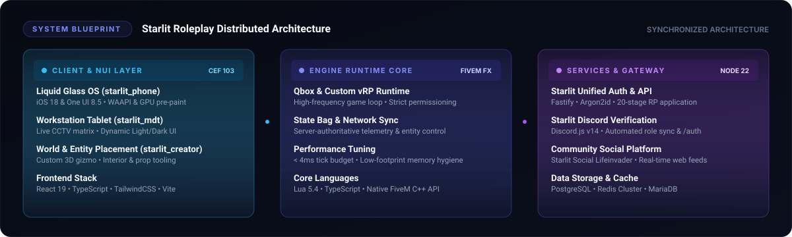

  <!-- Bespoke Hero Vector Banner -->
  

    

  <!-- Status & Community Badges -->
  

    
    
    
  

---

### ⚡ Core Engineering Focus

I specialize in **Game Systems Architecture** and **Full-Stack Engineering**, designing and maintaining high-performance production systems for the **Starlit Roleplay** platform:

* **In-Game Operating Systems & NUI:** Engineering high-FPS, liquid-glass user interfaces running inside FiveM's Chromium Embedded Framework (CEF 103). Designing true-to-life mobile and desktop operating systems with native physics, WAAPI animations, GPU pre-paint, and responsive layouts.
* **FiveM Engine & Gameplay Core:** Authoring low-latency server-authoritative game loops, state bag networking, synchronized world interactions, custom 3D placement gizmos, and anti-exploit protections across Qbox and customized vRP frameworks.
* **Distributed Cloud Services:** Architecting zero-trust authentication gateways, Argon2id security pipelines, 20-stage roleplay onboarding flows, and automated Discord bot synchronization built on top of Fastify, PostgreSQL, and Redis.

---

### 📐 System Architecture Blueprint

The diagram below outlines how client runtimes, game server cores, and external cloud infrastructure interact within the Starlit Roleplay ecosystem:

  

---

### 🛠️ Tech Stack & Tooling

  

 

  
<b>🔍 Detailed Technology Matrix & Usage</b>

   

| Tier | Primary Technologies | Core Focus in Production |
| :--- | :--- | :--- |
| **Game Engine & Core** | Lua 5.4, TypeScript, FiveM FXServer C++ APIs | High-frequency tick optimization (&lt; 4ms), state bag synchronization, entity routing |
| **In-Game NUI & Frontend** | React 19, TypeScript, TailwindCSS, Vite, CEF | Liquid Glass shaders, GPU pre-paint caching, accessible responsive web views |
| **Backend & Cloud APIs** | Node.js 22, Fastify, Express, Discord.js v14 | High-throughput JSON REST APIs, WebSocket events, automated role sync |
| **Databases & Cache** | PostgreSQL, Redis Cluster, MySQL / MariaDB | Persistent player identities, cached session tokens, low-latency leaderboard lookups |
| **Security & Tooling** | Argon2id, Zero-Trust Pipelines, Git, Docker, Linux | Fail-closed authentication, rate-limiting, hardened API proxies |

---

### 🌌 Production Ecosystem

<table>
  <tr>
    <td width="50%" valign="top">
      <h3 align="center">📱 starlit_phone (Liquid Glass OS)</h3>
      

        Full in-game smartphone operating system featuring dual design paradigms (iOS 18 Pro & One UI 8.5). Built with pure React 19, synchronized Dynamic Island, live camera/video recording, and GPU-cached glass rendering.
      

      

        <code>React 19</code> • <code>TypeScript</code> • <code>TailwindCSS</code> • <code>CEF 103</code> • <code>Lua</code>
      

    </td>
    <td width="50%" valign="top">
      <h3 align="center">🛡️ Starlit Unified Auth & Gateway</h3>
      

        Centralized single sign-on platform featuring a 20-stage roleplay vetting pipeline, SMTP email verification, Discord role synchronizer bot, and fail-closed FiveM gatekeeper.
      

      

        <code>Fastify</code> • <code>PostgreSQL</code> • <code>Redis</code> • <code>Discord.js</code> • <code>Argon2id</code>
      

    </td>
  </tr>
  <tr>
    <td width="50%" valign="top">
      <h3 align="center">📋 starlit_mdt (Tablet Workstation)</h3>
      

        Law enforcement and public administration terminal featuring real-time CCTV camera feeds, responsive Light/Dark glass interfaces, incident tracking, and player criminal history auditing.
      

      

        <code>React</code> • <code>TypeScript</code> • <code>State Management</code> • <code>FiveM Networked</code>
      

    </td>
    <td width="50%" valign="top">
      <h3 align="center">🌐 Starlit Social (Lifeinvader)</h3>
      

        Web-based community social networking platform tailored for city roleplay citizens with responsive browser layouts, instant messaging, media feeds, and game-world integration.
      

      

        <code>Full-Stack Web</code> • <code>Real-time Feeds</code> • <code>Responsive UI</code>
      

    </td>
  </tr>
</table>

---

### 📊 Telemetry & GitHub Activity

  
  

   
  

---

  

    <i>"Crafting immersive virtual worlds through disciplined systems architecture and pixel-level precision."</i>
  

  

    <strong>Starlit Roleplay</strong> • <code>wiski-i</code>
  

